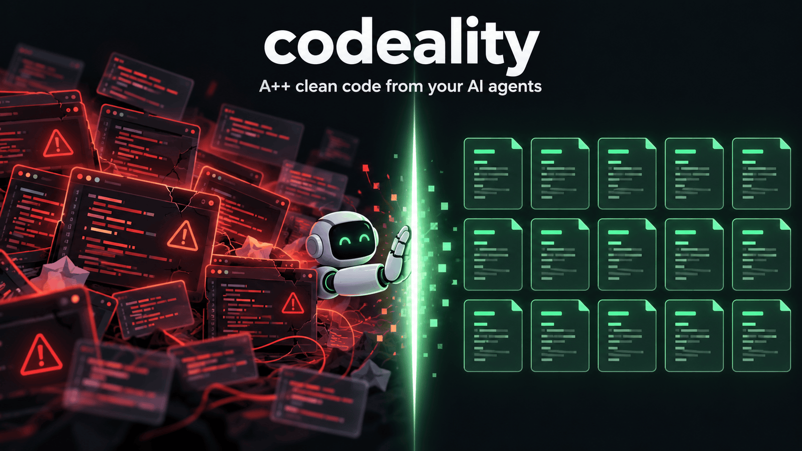
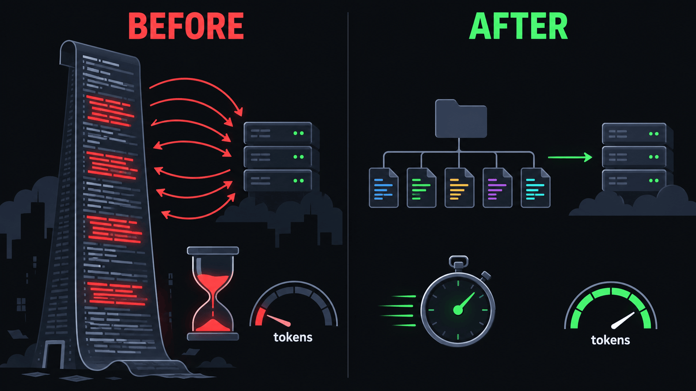
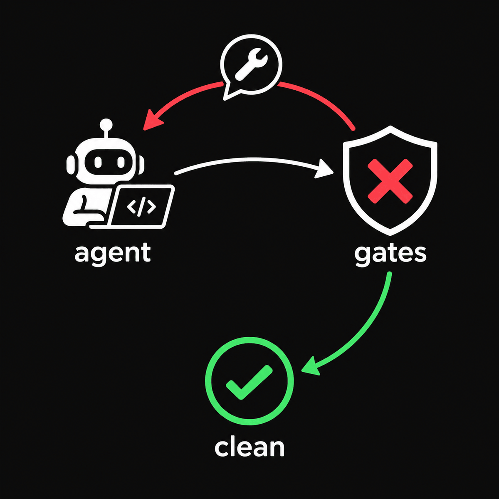

<p align="center"></p>

<h1 align="center">codeality</h1>

<p align="center"><b>A++ clean code from your AI agents. Zero effort for you. Fewer tokens for them.</b></p>

<p align="center">
Your agent writes fast. codeality makes it write <i>clean</i>: one unit per file,
no hidden helpers, no inline types, no duplicated blocks, no dead exports, no
import cycles - enforced by gates whose messages tell the agent what to fix.
You set it up once; the agent does the fixing.
</p>

<p align="center">
<a href="https://www.npmjs.com/package/eslint-plugin-code-policy"></a>
<a href="https://pypi.org/project/syntopica-codeality-py/"></a>
<a href="./LICENSE"></a>
</p>

```bash
pnpm dlx @syntopica/create-baseline --write   # add the missing gate config and scripts
pnpm dlx @syntopica/create-baseline --soft    # print the install line for what is missing
pnpm check:ci && pnpm check:quality           # then hand these two to your agent
```

Nothing you already have is overwritten: `--write` only adds files and scripts
that are missing.

---

## The problem

AI agents ship code that works and rots. Session after session they:

- pile a component, its hook, its types and three helpers into one 900-line
  file;
- copy a block that already exists two folders away;
- leave exports nobody imports;
- reach for `any` when a type gets in the way.

The next session has to read all of it to change one line. That is where your
tokens go.

## Before / after

<p align="center"></p>

**Before** - what an agent produces left alone (`src/UserList.tsx`, one file):

```tsx
import { useEffect, useState } from 'react'

type User = { id: string; name: string; teamId: string }
type Team = { id: string; name: string }

function formatName(name: string) {
  return name.trim().replace(/\s+/g, ' ')
}

export function UserList({ ids }: { ids: string[] }) {
  const [users, setUsers] = useState<(User & { team: Team })[]>([])
  useEffect(() => {
    ;(async () => {
      const out = []
      for (const id of ids) {
        const user = await fetch(`/api/users/${id}`).then((r) => r.json()) // N+1
        const team = await fetch(`/api/teams/${user.teamId}`).then((r) =>
          r.json(),
        )
        out.push({ ...user, team })
      }
      setUsers(out)
    })()
  }, [ids])
  return (
    <ul>
      {users.map((u) => (
        <li key={u.id}>
          {formatName(u.name)} - {u.team.name}
        </li>
      ))}
    </ul>
  )
}

export const unusedLegacyHelper = () => {} // dead export
```

**What codeality tells the agent** - real ESLint output on that file, excerpt:

```text
src/UserList.tsx
   3:1   error    Inline types (interfaces or type aliases) are not permitted within runtime files. Please extract this type into its own dedicated file (e.g., UserProps.ts or UserState.ts) according to the Atomic File architecture  code-policy/no-inline-types-in-runtime-files
   6:1   error    Top-level declaration "formatName" is not exported. The Primary Unit Rule forbids hidden internal helpers or types at the module scope  code-policy/no-hidden-top-level-declarations
  12:3   warning  Strict View Separation: The hook "useEffect" is forbidden in a view component. Extract your state/effects to a separate useUserList hook  code-policy/view-logic-separation
  16:15  error    Unsafe assignment of an `any` value  @typescript-eslint/no-unsafe-assignment
  36:14  error    File contains multiple primary exported units (found 2). The Atomic File Rule requires exactly one primary exported unit  code-policy/one-primary-unit

✖ 19 problems (16 errors, 3 warnings)
```

Warnings fail too: the templates' `lint` script and the generated pre-commit
hook run ESLint with `--max-warnings 0`, and `create-baseline` flags a `lint`
script that allows any.

**After** - the same feature once the gate is green (0 problems):

```text
src/users/
  types/User.ts
  types/Team.ts
  types/UserWithTeam.ts
  types/UserListProps.ts
  services/fetchUsersWithTeams.ts
  hooks/useUserList.ts
  UserList.tsx
src/shared/formatters/formatName.ts
```

```tsx
import { formatName } from '../shared/formatters/formatName'
import type { UserListProps } from './types/UserListProps'

export function UserList({ users }: UserListProps) {
  return (
    <ul>
      {users.map((user) => (
        <li key={user.id}>
          {formatName(user.name)} - {user.team.name}
        </li>
      ))}
    </ul>
  )
}
```

Small files with one job each. The next agent opens the 15-line file it needs
instead of the whole feature. Both versions are in
[`docs/examples/user-list`](./docs/examples/user-list) with the commands to
reproduce the lint result.

One honest note: the gates forced the split, not the batched request. Replacing
the N+1 loop with one `fetchUsersWithTeams` call was the agent's design choice -
but in a 10-line service file it is a choice the agent can actually see.

## Why it works with agents

<p align="center"></p>

- **Error messages are instructions.** The structural rules name the declaration
  and the kind of file it belongs in. The agent fixes it without asking you.
- **Gates, not guidelines.** A `CLAUDE.md` saying "write clean code" is a wish.
  A red `check:ci` is a fact the agent cannot talk its way around.
- **Adopt on a messy repo today.** `lint:suppress` records existing ESLint
  errors so only new ones fail; see the
  [existing-repo guide](./docs/adoption/existing-repo.md) for warnings and the
  other gates.

## What strict rules buy you

Every rule here costs the agent a few seconds once and pays back on every
session after it.

### Less context, fewer tokens

- **Atomic files** (one exported unit per file) mean the agent loads the 20
  lines it needs, not the 900 around them. Reading is most of what an agent
  spends.
- **The file name is the index.** `useUserList.ts` holds `useUserList`. The
  agent finds code with `ls` and `grep` instead of reading files to discover
  what is in them.
- **Predictable placement** (`file-kind-placement`): hooks go in `hooks/`,
  formatters in `formatters/`, mappers in `mappers/`, and `utils/` or `helpers/`
  folders are rejected outright. The agent knows where code lives and where new
  code goes.
- **No dead code** (knip): nothing unused for the agent to read, keep in sync,
  or copy as an example.

### Smaller blast radius, fewer broken edits

- **A change touches one small file.** Fewer lines in play means fewer
  accidental edits to code next door, and search-and-replace edits are far more
  likely to match exactly once.
- **Public entry points only** (`public-api-imports`,
  `no-cross-module-deep-imports`): callers depend on a module's front door, so
  the agent can rewrite its internals without breaking anything outside.
- **No import cycles** (dependency-cruiser): each module can be understood and
  changed on its own.
- **One copy of every block** (jscpd): a bug fixed once is fixed everywhere,
  instead of the agent patching one copy and missing the other two.
- **Types in their own files**: one definition reused across the codebase,
  instead of a slightly different `User` redefined in every file that needs one.
- **Strict TypeScript**: an API the agent invented fails the type check, not
  production.

### Easier to review, safer to parallelize

- **Small diffs.** A pull request made of 30-line files reads in minutes; one
  that rewrites half of a 900-line file does not.
- **Fewer merge conflicts.** Several agents or worktrees working at once are
  less likely to touch the same small file.
- **Views without logic** (`view-logic-separation`): components render, hooks
  hold state and effects, so the logic can be tested without rendering markup.

### Faster loops, better product (optional gates)

- **Cheaper test suites** (test-quality): finds DOM environments booted for
  files that never touch the DOM, and files that two projects both run.
- **Eyes for the UI** (ui-quality): an agent cannot see the page it built. The
  gate renders your routes in light and dark at several widths and reports
  contrast, clipping, misaligned columns and off-palette colours.
- **Database checks** (db-quality): Supabase migrations and Prisma/Drizzle
  schemas linted before they reach production.
- **Checks at commit time** (lefthook): problems surface in seconds on the
  agent's machine, not minutes later in CI.

## Give this to your agent

Paste this into `CLAUDE.md`, `AGENTS.md`, `.cursor/rules` or the start of a
task:

```text
Before you finish, run `pnpm check:ci` and `pnpm check:quality`. Fix every finding they report and run them again until both pass. If a finding needs a judgment call, follow the existing conventions of the repository and say what you decided.
```

It works with Claude Code, Cursor, Codex and any agent that can run a shell
command, because it relies on your repository's scripts rather than an
agent-specific integration.

## What gets checked

**Core** - wired by `create-baseline --write`:

| Package                      | Reports                                                                                                                   |
| ---------------------------- | ------------------------------------------------------------------------------------------------------------------------- |
| `eslint-plugin-code-policy`  | multiple exported units, hidden top-level helpers, inline types, misplaced files, deep imports, mixed barrels, view logic |
| `@syntopica/eslint-config`   | strict flat ESLint for Next.js, Astro, Vite React/Vue, Nuxt, Node                                                         |
| `@syntopica/quality-config`  | duplicated blocks (jscpd), unused files/exports/deps (knip), import graph violations (dependency-cruiser)                 |
| `@syntopica/tsconfig`        | strict TypeScript presets                                                                                                 |
| `@syntopica/prettier-config` | formatting, import order, Tailwind class order                                                                            |

**Optional** - each installed and configured on its own:

| Package                   | Reports                                                                                        |
| ------------------------- | ---------------------------------------------------------------------------------------------- |
| `@syntopica/test-quality` | test-suite cost: unneeded DOM environments, files run twice, uncached lint in git hooks        |
| `@syntopica/ui-quality`   | rendered routes in light and dark: contrast, clipping, misaligned columns, off-palette colours |
| `@syntopica/db-quality`   | Supabase migrations, Prisma/Drizzle schemas, SQLite files, live Supabase project audit         |
| `syntopica-codeality-py`  | the same structural rules for Python, plus one aggregated gate                                 |
| `cargo-baseline`          | the same structural rules for Rust                                                             |

## Quick start

**Existing repo:**

```bash
pnpm dlx @syntopica/create-baseline --write
pnpm dlx @syntopica/create-baseline --soft    # run the install line it prints
pnpm check:ci
pnpm check:quality
```

Review what `--write` generated before committing: `deps:graph` is scoped to
`src`, and e2e specs or hand-run scripts need declaring as knip entry points.
Already have lint debt? Follow the
[existing-repo guide](./docs/adoption/existing-repo.md).

**New repo:** copy a template from [`templates/`](./templates) - Next.js, Astro,
Vite + React, Vue, Nuxt 4, NestJS, Tauri, TS package, Python package - then
`pnpm install && pnpm check:ci`.

**Python:**

```bash
uvx --from syntopica-codeality-py codeality-py gate --project .
```

## How it fits with your tools

ESLint checks one file at a time; codeality adds the structural rules ESLint
does not ship (one unit per file, placement, entry points) and the whole-tree
checks it cannot do (duplication, dead code, import graph) through knip, jscpd
and dependency-cruiser. If you use Biome for formatting, keep it. SonarQube is a
hosted analysis platform; codeality is a set of local gates an agent can run and
fix in the same loop, with no server.

## FAQ

**Will it rewrite my code?** No. `--write` adds missing config files and
scripts. The fixing is done by you or your agent, one finding at a time.

**Are the token savings measured?** Not yet. The argument is the mechanism:
smaller, findable units mean less to read per change. A before/after measurement
on a real repository is in progress.

**Can I adopt one piece at a time?** Yes. Every package installs and runs on its
own; start with the core and add the optional gates when you need them.

**Does it work without an AI agent?** Yes. The gates do not know who wrote the
code. Agents just benefit most, because they read so much of it.

## Docs

- [Engineering guide](./docs/engineering-guide.md) - the full standard
- [Quality gates](./docs/standards/quality-gates.md) - every gate, its
  threshold, how to handle a false positive
- Adoption: [new repo](./docs/adoption/new-repo.md),
  [existing repo](./docs/adoption/existing-repo.md),
  [migration](./docs/migration.md)
- [Platform decisions](./docs/platform-decisions.md)
- [Maintainers](./docs/maintainers.md) - publishing, CI pipeline, patches

---

If codeality caught something your agent would have shipped,
[give it a star](https://github.com/syntopica/codeality) - it helps other people
find it.

## License

[MIT](./LICENSE)
